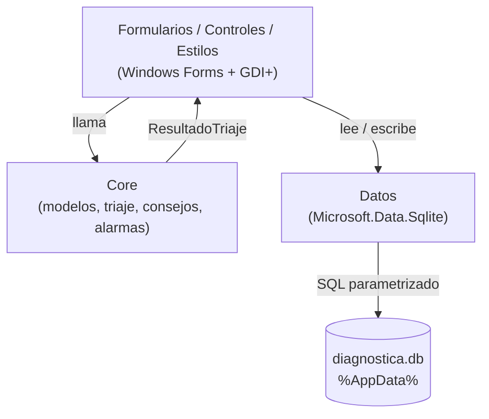
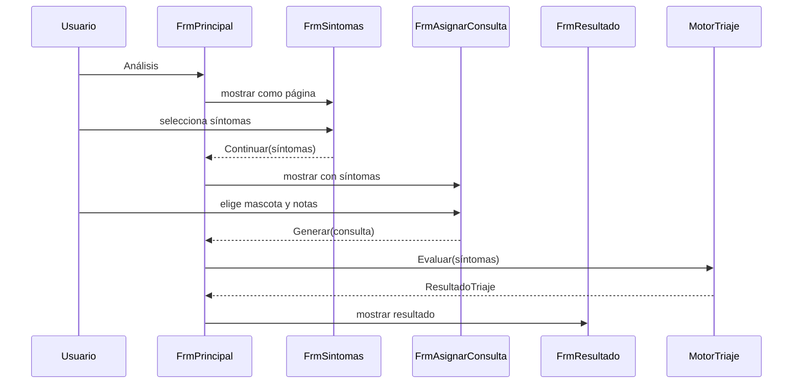

# Arquitectura

## Visión general

La aplicación sigue una **arquitectura por capas** sencilla. La capa de dominio (`Core`) no
conoce Windows Forms; la capa de datos (`Datos`) sabe de SQLite; la capa de presentación
(`Formularios` + `Controles` + `Estilos`) es la única que dibuja ventanas.

## Capas

### `Core` — dominio

| Archivo | Responsabilidad |
|---|---|
| `Modelos.cs` | `Mascota`, `Consulta`, `Recordatorio`, `NivelSeveridad`, `ResultadoTriaje` |
| `MotorTriaje.cs` | Diccionario de 20 síntomas, reglas de urgencia y textos de resultado |
| `CatalogoConsejos.cs` | Consejos por tema y por nivel de severidad |
| `ServicioAlarmas.cs` | Decide qué recordatorio debe sonar en un minuto dado |

Regla de oro: **no hay `using System.Windows.Forms` en esta carpeta** (salvo el tipo `Color`
usado por `MotorTriaje.ColorNivel`, que pertenece a `System.Drawing`).

### `Datos` — persistencia

`Almacenamiento` mantiene listas en memoria (`Mascotas`, `Consultas`, `Recordatorios`) y refleja
cada cambio en SQLite de inmediato. Todas las sentencias usan parámetros (`$id`, `$nombre`, ...)
para evitar inyección SQL. `DatosIniciales` aporta los ejemplos de la primera ejecución.

### `Estilos` — "CSS" de la aplicación

| Archivo | Responsabilidad |
|---|---|
| `Tema.cs` | Paleta `theme.css` (oscuro/claro), fuentes y aplicación del tema |
| `Dibujo.cs` | Esquinas redondeadas, degradados, sombras, brillos y texto |
| `Iconos.cs` | Iconos de la fuente de Windows + huella y destello dibujados a mano |
| `Animador.cs` | Curvas de animación, bucle, animation de aparición y resorte |

### `Controles` — componentes visuales propios

Botones (`BotonRedondeado`, `BotonOpcion`, `BotonCategoria`), tarjetas (`PanelTarjeta`,
`TarjetaFuncion`, `TarjetaMascota`, `TarjetaConsulta`, `TarjetaRecordatorio`, `TarjetaLista`),
navegación (`PanelLateral`, `ElementoNav`), campos (`CajaTexto`, `ListaDesplegable`,
`SelectorFecha`), retroalimentación visual (`BannerUrgencia`, `BarraProgreso`, `Notificacion`, `EstadoVacio`,
`AvisoMedico`, `CapaTransicion`) y elementos animados (`HeroAnimado`, `LogoAnimado`,
`InterruptorTema`).

### `Formularios` — presentación

- `Base/PaginaBase`: base de las páginas embebidas; da estilo y animación de entrada.
- `Base/ModalBase`: fondo oscurecido y contenedor de modales.
- `Base/Dialogos`: confirmaciones y avisos con el estilo de la app.
- `FrmPrincipal`: barra lateral, área de contenido y temporizador de alarmas.
- Resto de `Frm*`: una responsabilidad por pantalla (ver [navegación](../README.md#navegación)).

## Flujo de comunicación

## Decisiones derivadas

- **Una base, un archivo**: no hay servidor; se puede copiar o respaldar el `.db` directamente.
- **Sin autenticación**: app local de un solo usuario.
- **Sin dependencias de UI**: todo se dibuja con GDI+ para control total del aspecto.
- **Páginas embebidas**: evita múltiples ventanas y mantiene la barra lateral siempre visible.

Más detalle en [DECISIONES_DISENO.md](DECISIONES_DISENO.md) y en los
[diagramas](INDICE.md#diagramas).
