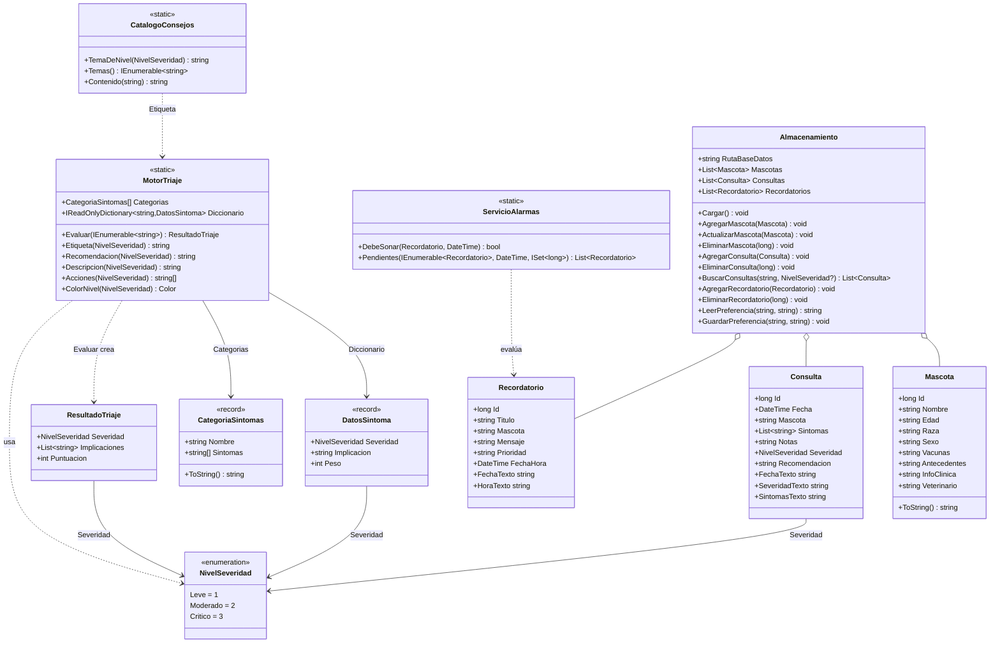

# Diagrama de clases del dominio

Modelos y servicios de la capa `Core`. Es el corazón de la aplicación y es independiente de la
interfaz.

## Notas

- `DatosSintoma` y `CategoriaSintomas` son `record` (inmutables por defecto).
- `Consulta.Mascota` guarda el **nombre** como texto, no una clave foránea: el historial sobrevive
  aunque se borre la ficha de la mascota.
- `ResultadoTriaje.Puntuacion` es la suma de pesos; `Implicaciones` contiene una explicación por
  síntoma reconocido.

Volver al [índice de documentación](../INDICE.md#diagramas).
