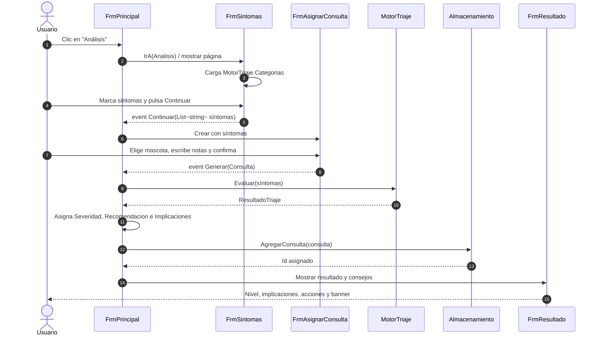
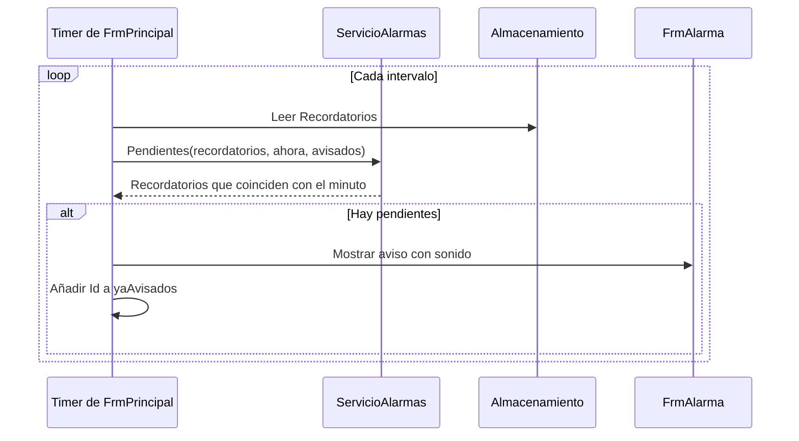

# Diagrama de secuencia: análisis de síntomas

Flujo completo desde que el usuario marca síntomas hasta que se guarda la consulta y se muestra
el resultado.

## Guardado en SQLite

`Almacenamiento.AgregarConsulta` ejecuta tres pasos lógicos:

1. `INSERT INTO Consultas (...)` con parámetros.
2. `INSERT INTO ConsultaSintomas (ConsultaId, Orden, Sintoma)` por cada síntoma, respetando el orden
   de selección.
3. Actualiza la lista en memoria para que el historial refleje el cambio al instante.

## Alarmas

Volver al [índice de documentación](../INDICE.md#diagramas).
