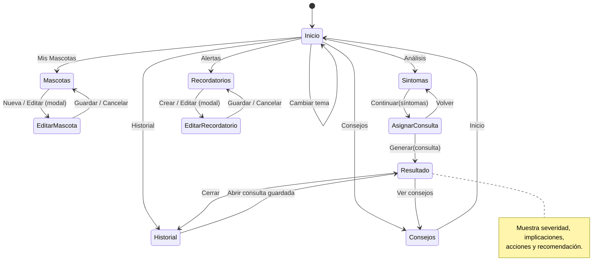

# Diagrama de estados: navegación

Las páginas se muestran dentro de `FrmPrincipal`. Cada transición la decide el formulario principal
en respuesta a eventos de la página activa.

## Secciones de la barra lateral

| Sección | Enum | Formulario principal |
|---|---|---|
| Inicio | `Seccion.Inicio` | `FrmInicio` |
| Mis Mascotas | `Seccion.Mascotas` | `FrmMascotas` |
| Análisis | `Seccion.Analisis` | `FrmSintomas` |
| Historial | `Seccion.Historial` | `FrmHistorial` |
| Alertas | `Seccion.Alertas` | `FrmRecordatorios` |
| Consejos | `Seccion.Consejos` | `FrmConsejos` |

`FrmPrincipal.IrA(Seccion)` centraliza el cambio de página y aplica la animación de entrada.
Los formularios modales (`FrmEditarMascota`, `FrmEditarRecordatorio`, `FrmAlarma`,
`FrmConfirmar`) se abren con `MostrarSobre(this)` sobre el control que los invoca.

Volver al [índice de documentación](../INDICE.md#diagramas).
