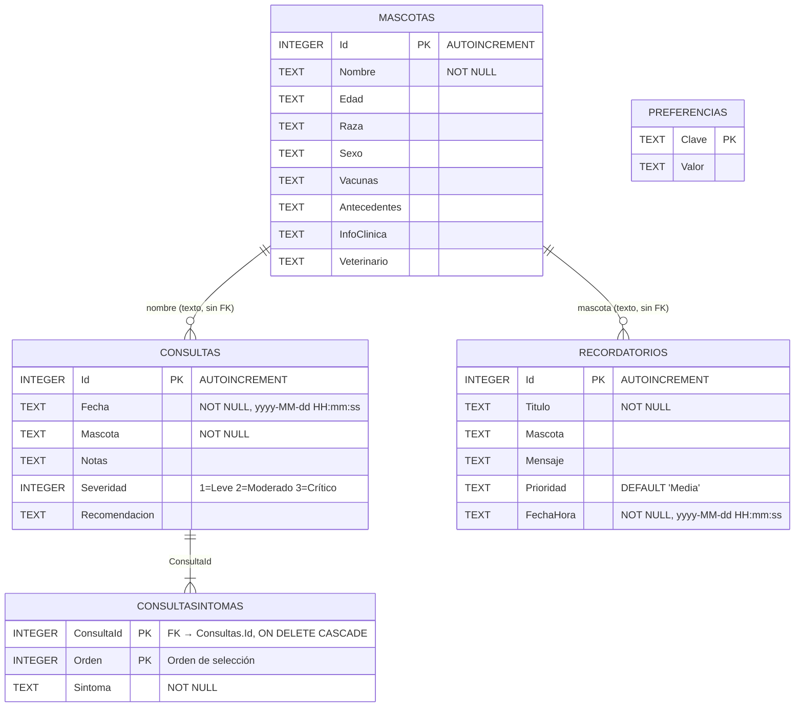

# Modelo de datos y DDL

La base es un único archivo SQLite en `%AppData%\DiagnosticaTuMascota\diagnostica.db`.

## Diagrama entidad-relación



> `Consultas.Mascota` y `Recordatorios.Mascota` guardan el **nombre** como texto. No son claves
> foráneas: así el historial se conserva aunque se elimine la ficha de la mascota.

## DDL utilizado por `Almacenamiento.Cargar()`

```sql
CREATE TABLE IF NOT EXISTS Mascotas (
    Id           INTEGER PRIMARY KEY AUTOINCREMENT,
    Nombre       TEXT NOT NULL,
    Edad         TEXT,
    Raza         TEXT,
    Sexo         TEXT,
    Vacunas      TEXT,
    Antecedentes TEXT,
    InfoClinica  TEXT,
    Veterinario  TEXT
);

CREATE TABLE IF NOT EXISTS Consultas (
    Id            INTEGER PRIMARY KEY AUTOINCREMENT,
    Fecha         TEXT NOT NULL,
    Mascota       TEXT NOT NULL,
    Notas         TEXT,
    Severidad     INTEGER NOT NULL,
    Recomendacion TEXT
);

CREATE TABLE IF NOT EXISTS ConsultaSintomas (
    ConsultaId INTEGER NOT NULL REFERENCES Consultas(Id) ON DELETE CASCADE,
    Orden      INTEGER NOT NULL,
    Sintoma    TEXT NOT NULL,
    PRIMARY KEY (ConsultaId, Orden)
);

CREATE TABLE IF NOT EXISTS Recordatorios (
    Id        INTEGER PRIMARY KEY AUTOINCREMENT,
    Titulo    TEXT NOT NULL,
    Mascota   TEXT,
    Mensaje   TEXT,
    Prioridad TEXT NOT NULL DEFAULT 'Media',
    FechaHora TEXT NOT NULL
);

CREATE TABLE IF NOT EXISTS Preferencias (
    Clave TEXT PRIMARY KEY,
    Valor TEXT
);
```

## Consultas habituales

```sql
-- Historial filtrado por mascota y nivel
SELECT c.*
FROM Consultas c
WHERE (@mascota IS NULL OR c.Mascota LIKE '%' || @mascota || '%')
  AND (@nivel  IS NULL OR c.Severidad = @nivel)
ORDER BY c.Fecha DESC;

-- Síntomas de una consulta, en el orden elegido
SELECT Sintoma
FROM ConsultaSintomas
WHERE ConsultaId = @id
ORDER BY Orden;

-- Preferencia de tema
SELECT Valor FROM Preferencias WHERE Clave = 'tema';
```

Todas las sentencias desde C# usan `SqliteParameter` (`$nombre`, `$id`, ...); los ejemplos de arriba
emplean `@` solo para ilustrar el filtro en SQL puro.

Volver al [índice de documentación](../INDICE.md#diagramas).
